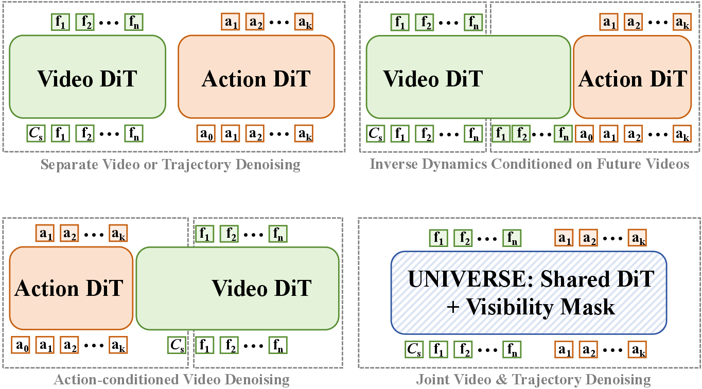
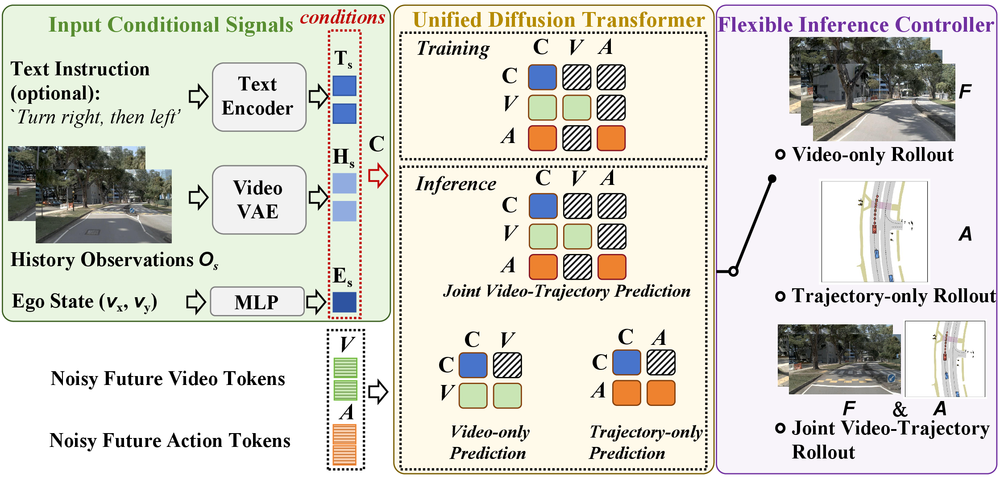
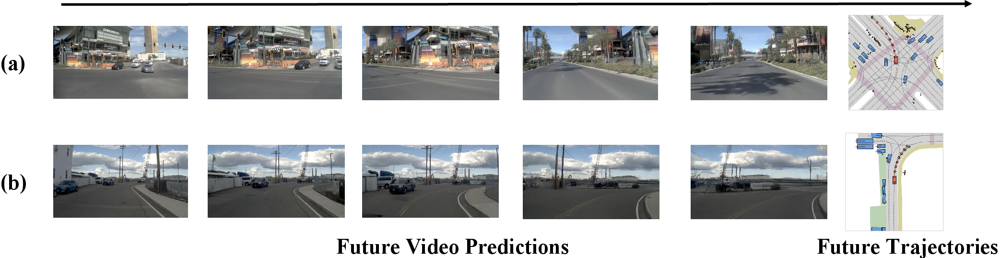
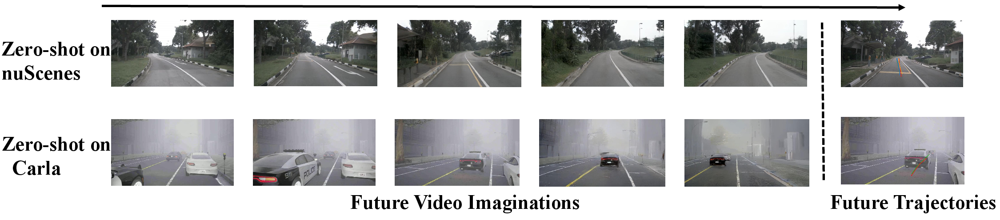

<div align="center">

# UNIVERSE

### Unified Video Action Models for Autonomous Driving with Flexible Mask-Modulated Modality Generation

**NeurIPS 2026**

Mengmeng Liu<sup>1</sup>, Diankun Zhang<sup>2</sup>, Jiuming Liu<sup>3</sup>,<br>
Jianfeng Cui<sup>2</sup>, Hongwei Xie<sup>2</sup>, Guang Chen<sup>2</sup>,
Hangjun Ye<sup>2</sup>,<br>
Michael Ying Yang<sup>4</sup>, Francesco Nex<sup>1</sup>, Hao Cheng<sup>1</sup>

<sup>1</sup>University of Twente&nbsp;&nbsp;
<sup>2</sup>Xiaomi EV&nbsp;&nbsp;
<sup>3</sup>University of Cambridge&nbsp;&nbsp;
<sup>4</sup>University of Bath

[](https://arxiv.org/abs/2607.05133)
[](https://huggingface.co/mengmengliu1998/UNIVERSE)
[](examples/wanvideo/UNIVERSE_train/README.md)
[](examples/wanvideo/UNIVERSE_infer/README.md)

</div>

## News

- **November 9th, 2026:** The code has migrated to the new repository [xiaomi-research/universe](https://github.com/xiaomi-research/universe). Stars are welcome!
- **November 9th, 2026:** The UNIVERSE code is now open-sourced on GitHub.
- **September 25th, 2026:** UNIVERSE is accepted by NeurIPS 2026.
- **July 6th, 2026:** UNIVERSE is released on [arXiv](https://arxiv.org/abs/2607.05133).

## Overview

UNIVERSE is a unified video-action model based on a single mask-modulated
Diffusion Transformer. Future video latents and ego-trajectory tokens are
co-trained with shared parameters, while the Modality-Decoupling Visibility
Mask prevents leakage between future modalities. The same model supports
video-only, trajectory-only, and joint video-trajectory generation.

<div align="center">
<b>UNIVERSE shares video and trajectory denoising in a single DiT.</b>


<b>Overall pipeline and flexible inference modes.</b>

</div>

The visibility mask shares historical context across modalities but blocks
attention between future video and trajectory targets. At inference time, the
future token groups determine whether the model produces video, trajectory, or
both. The released planning launchers use trajectory-only inference by default.

## Qualitative Results

<div align="center">
<b>Joint future-video and trajectory prediction.</b>


<b>Zero-shot transfer from NavSIM to nuScenes and Bench2Drive.</b>

</div>

UNIVERSE is trained on NavSIM and evaluated on nuScenes and Bench2Drive without
target-dataset fine-tuning. See the paper for the complete quantitative results,
ablation studies, and evaluation protocol.

## Installation

The recommended environment is Linux with Python 3.10, Git, CUDA, and a
CUDA-capable GPU.

```bash
git clone --branch UNIVERSE --single-branch \
  https://github.com/xiaomi-mlab/VideoDrive-dev.git
cd VideoDrive-dev

export REPO_ROOT="$(pwd)"

apt-get update && apt-get install -y libgl1-mesa-glx libglib2.0-0
python -m pip install "setuptools==60.2.0"
python -m pip install -e .
```

Install FlashAttention and the nuPlan devkit from their official repositories
when required by your environment:

- FlashAttention: https://github.com/Dao-AILab/flash-attention
- nuPlan devkit: https://github.com/motional/nuplan-devkit

For nuScenes inference, clone the official devkit into the expected location:

```bash
git clone https://github.com/nutonomy/nuscenes-devkit.git \
  third_party/nuscenes-devkit
```

## Model Preparation

Download Wan2.2 and the released UNIVERSE checkpoint to the default locations:

```bash
python -m pip install -U "huggingface_hub[cli]"

mkdir -p models/Wan-AI checkpoints

huggingface-cli download Wan-AI/Wan2.2-TI2V-5B \
  --local-dir models/Wan-AI/Wan2.2-TI2V-5B

huggingface-cli download mengmengliu1998/UNIVERSE \
  step-200-ema.safetensors \
  --local-dir checkpoints

mv checkpoints/step-200-ema.safetensors checkpoints/UNIVERSE.safetensors
```

The launchers use `models/` and `checkpoints/UNIVERSE.safetensors` by default.
Override them with `LOCAL_MODEL_PATH` and `FULL_CKPT`.

## Training

UNIVERSE training uses NavSIM v1. Configure the dataset paths and launch
distributed training:

```bash
export NAVSIM_LOG_PATH=/path/to/navsim_v1.1/navsim_logs/trainval
export SENSOR_BLOBS_PATH=/path/to/nuplan/dataset/nuplan-v1.1/sensor_blobs
export NUPLAN_MAPS_ROOT=/path/to/nuplan/dataset/maps
export NUPLAN_DATA_ROOT=/path/to/navsim_v1.1/dataset
export LOCAL_MODEL_PATH=$PWD/models

bash examples/wanvideo/UNIVERSE_train/scripts/train_dist_multi_node_navsim.sh
```

Training starts from the configured Wan2.2 base model unless `FULL_CKPT` is
set. See the [training guide](examples/wanvideo/UNIVERSE_train/README.md) for
distributed settings, checkpoint output, automatic evaluation, and smoke tests.

## Inference

The released configuration uses three flow-matching sampling steps for NavSIM,
nuScenes, and Bench2Drive. Run all three datasets sequentially with:

```bash
bash examples/wanvideo/UNIVERSE_infer/scripts/infer_all.sh
```

Or run one dataset at a time:

```bash
bash examples/wanvideo/UNIVERSE_infer/scripts/eval_navsim_v1.sh
bash examples/wanvideo/UNIVERSE_infer/scripts/infer_nuscenes.sh
bash examples/wanvideo/UNIVERSE_infer/scripts/infer_bench2drive.sh
```

Dataset paths are supplied through environment variables or the YAML files in
`examples/wanvideo/UNIVERSE_infer/configs/`. See the
[inference guide](examples/wanvideo/UNIVERSE_infer/README.md) for required
variables, evaluation caches, smoke tests, and output locations.

## Project Layout

| Path | Purpose |
| --- | --- |
| `examples/wanvideo/UNIVERSE_train/` | NavSIM v1 training and automatic evaluation |
| `examples/wanvideo/UNIVERSE_infer/` | NavSIM, nuScenes, and Bench2Drive inference |
| `diffsynth/` | Wan2.2 model, shared video-action pipeline, and training runtime |
| `third_party/navsim/` | Bundled NavSIM runtime required by evaluation |
| `assets/universe_*.png` | Architecture and qualitative figures |

## Acknowledgments

UNIVERSE builds on and is inspired by the following open-source projects and
benchmarks:

- DiffSynth-Studio: https://github.com/modelscope/DiffSynth-Studio
- Wan2.2: https://github.com/Wan-Video/Wan2.2
- NAVSIM: https://github.com/autonomousvision/navsim
- nuScenes devkit: https://github.com/nutonomy/nuscenes-devkit
- nuPlan devkit: https://github.com/motional/nuplan-devkit
- Bench2Drive: https://github.com/Thinklab-SJTU/Bench2Drive
- FlashAttention: https://github.com/Dao-AILab/flash-attention
- Diffusers: https://github.com/huggingface/diffusers

## Citation

```bibtex
@article{liu2026universe,
  title={UNIVERSE: Unified Video Action Models for Autonomous Driving with Flexible Mask-Modulated Modality Generation},
  author={Liu, Mengmeng and Zhang, Diankun and Liu, Jiuming and Cui, Jianfeng and Xie, Hongwei and Chen, Guang and Ye, Hangjun and Nex, Francesco and Cheng, Hao and Yang, Michael Ying},
  journal={arXiv preprint arXiv:2607.05133},
  year={2026}
}
```
